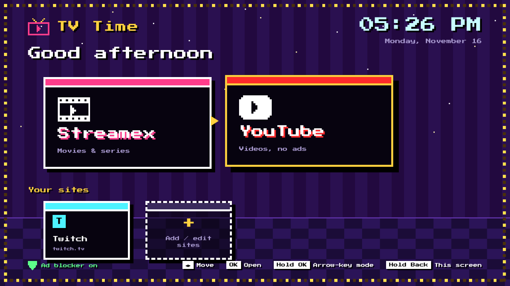

# TV Time

A TV home screen with **Streamex** and **YouTube**, a **built-in ad blocker** (YouTube ads
included) and **TV-remote control** - including the video players from the different server
providers that Streamex embeds.

Two versions share the same start page and blocking code:

* **Android app** - Android TV, Google TV, Fire TV, TV boxes, phones, tablets (Android 5.0+).
* **Raspberry Pi** - boots straight into the start page in full-screen Chromium; your normal
  TV remote works through HDMI-CEC. See [Raspberry Pi](#raspberry-pi).

## The start page



A retro pixel-art home screen: a stage with a striped back wall, a checkered floor, twinkling
stars and chasing bulbs around the edge, with menu-window tiles for Streamex and YouTube, a clock
and **Your sites** (*Add / edit sites* adds any other website as a tile, or removes one). Move
around with the arrow keys; a blinking pointer marks the selected tile, with a little chiptune
blip on each move and on opening a tile. Source: `web/start/`. The pixel font is Press Start 2P
(SIL Open Font License, `web/start/fonts/`).

### Startup intro

When the app or the Pi starts, a retro pixel-art intro plays before the start page (about 7
seconds, any button skips it):

1. an old TV switches on, static, a "CH 03" channel number
2. a flash, then a pixel stage with sweeping spotlights, stars, chasing bulbs and a checkered floor
3. **"IT'S TV TIME!"** drops in letter by letter, in time with the voice line - every letter lands
   with a *bwip* and a screen shake
4. the "!" sets off a white flash, a star burst and a chiptune fanfare
5. applause, then a pixel circle opens onto the start page

It plays once per start-up; *Add / edit sites* has an on/off switch and a *Play it now* button.
Everything is drawn on one 180-pixel-high canvas (`web/start/intro.js`).

**Voice line:** `web/start/intro-sound.mp3` (`.ogg`, `.wav`, `.m4a` also work). The moment of each
word is set in `web/start/intro-sound-timing.js` (in seconds); without that file it's estimated
from the clip's length. Without any clip, an 8-bit fanfare plays instead.

**Sound effects:** all chiptune, generated in code. Any of them can be replaced by your own file in
`web/start/sfx/` (`.mp3`, `.ogg` or `.wav`):

| File name | When it plays |
|---|---|
| `power` | the TV switching on |
| `channel` | the "CH 03" channel number appearing |
| `land` | each letter landing |
| `bang` | the "!" (flash and star burst) |
| `sparkle` | stars twinkling afterwards |
| `cheer` | the crowd after the voice line |
| `jingle` | the fanfare, only when there is no voice line |

After changing sounds or the clip:
* Raspberry Pi: `python3 pi/build-extension.py` (or `./pi/install.sh` again) and restart.
* Android: commit and let GitHub build a new APK.

## Get the APK

Every push is built automatically by GitHub Actions (`.github/workflows/build.yml`):

* **Any branch:** open the repo's **Actions** tab, pick the latest "Build APK" run and download
  `tv-time-apk` from the **Artifacts** section (it's a zip with `tv-time.apk` inside).
* **`main` branch:** the APK is also published as a release, so a TV can fetch it directly:
  `https://github.com/ThatsALotOfBees2/tv-time/releases/latest/download/tv-time.apk`

### Automatic updates

Every build of the `main` branch is published as a GitHub release with `tv-time.apk` and
`version.json`. Each time the app starts it reads
`https://github.com/ThatsALotOfBees2/tv-time/releases/latest/download/version.json`; if that
version is newer, an update screen downloads it with a progress bar and then asks you to press OK
to install. The app can't be used until it's updated (only a *failed* download can be skipped).
Android shows its own "update this app?" screen; after installing, TV Time closes - open it again.
The first time, Android asks you to allow TV Time to install apps.

**The repository must be public** (or the releases must be on a public repository) - Android
can't download release files from a private GitHub repository. To point the app somewhere else,
change `update_url` in `app/build.gradle.kts`; an empty value switches it off.

### Installing on a TV
1. On the TV, enable *Settings -> Device Preferences -> Security -> Unknown sources*
   (Fire TV: *My Fire TV -> Developer options -> Install unknown apps*).
2. Install the free **Downloader** app, type the release URL above, and install.
   Or copy the APK with a USB stick and open it with a file manager.
3. TV Time appears on the home screen with its banner.

Every build is signed with the same key (`app/tvtime.keystore`), so new versions install
over old ones without losing your settings.

## Using it with a remote

| Button | Pointer mode (default) | Player mode (fullscreen video) |
|---|---|---|
| D-pad arrows | move the on-screen pointer (hold to speed up; push against an edge to scroll) | Left/Right: seek -/+10 s, Up/Down: back to pointer |
| OK | click where the pointer is | play / pause |
| **Hold OK** or **MENU** | open the TV Time menu | open the menu |
| Back | go back a page (twice on the first page to exit) | leave fullscreen |
| **Hold Back** | open the menu | open the menu |
| Play/Pause, FF, Rewind | control the video | control the video |
| Channel +/- | scroll a full page | |

The pointer sends real taps, so it works inside every embedded video player (server 1,
server 2, ...) no matter which provider hosts it. When a video goes fullscreen the app
switches to Player mode automatically; you can also turn it on from the menu.

On the start page the arrows move the highlight between tiles instead of the pointer.

**Menu:** Home, Start page, Back, Forward, Reload, Go to address/search, Player controls mode, Zoom,
Ad blocker on/off (with blocked count), Block redirects on/off, Desktop version of sites,
Make this page my Home, Clear cookies & cache, Exit.

## How the ad blocking works

**Android app:** the app runs on Firefox's browser engine (GeckoView) with **uBlock Origin**
built in - the same filter lists Brave Shields uses (EasyList, EasyPrivacy, uBlock filters,
Peter Lowe's list) plus uBO's scriptlets for YouTube and streaming-site tricks. It is downloaded
fresh into every build (`tools/fetch-ublock.sh`) and keeps its lists updated. On top of that:
* pop-ups and new windows are never opened;
* the page may only navigate to sites you chose (Streamex, YouTube, your tiles) - hijacked
  clicks are stopped with "Blocked redirect to ...";
* invisible click-trap overlays over players are removed (`app/src/main/assets/inject.js`).

Because GeckoView brings its own up-to-date engine, the app no longer depends on the TV's
Android System WebView. The APK is bigger (one per CPU type, ~60-80 MB); the updater downloads
the right one.

**Raspberry Pi:** runs the real **Brave browser**, so it's Brave Shields 1:1 (Chromium is used
only on 32-bit Pi OS, where Brave isn't available), plus the TV Time extension's pop-up killer,
redirect guard and YouTube script.

**Building locally:** run `tools/fetch-ublock.sh` once before `./gradlew assembleRelease`.

## Changing the home screen

The app opens the start page by default (`default_home_url` in `app/src/main/res/values/strings.xml`).
To open a site directly instead: *Menu -> Go to address*, then *Menu -> Make this page my Home*.
The big tiles are defined at the top of `web/start/start.js`.

## Building locally

Needs the Android SDK (Android Studio, or command-line tools with `ANDROID_HOME` set) and JDK 17+:

```
./gradlew assembleRelease
# -> app/build/outputs/apk/release/app-release.apk
```

## Raspberry Pi

Turns a Raspberry Pi (4 or 5 recommended) into a TV box: it boots straight to the TV Time start
page in full-screen Chromium, with the TV Time extension doing the ad / pop-up / redirect
blocking, and your TV's own remote driving it over HDMI-CEC.

### Setup
On a fresh **Raspberry Pi OS (with desktop)**, open a terminal and run:

```
git clone https://github.com/ThatsALotOfBees2/tv-time.git
cd tv-time
./pi/install.sh
sudo reboot
```

Make sure HDMI-CEC is switched on in your TV's settings (it has a brand name: Samsung *Anynet+*,
LG *SimpLink*, Sony *Bravia Sync*, Philips *EasyLink*, Panasonic *VIERA Link*...).

### Remote control on the Pi

| Button | Pointer mode (default) | Arrow-key mode |
|---|---|---|
| Arrows | move the pointer (hold = faster, push against an edge = scroll) | real arrow keys (start page, video players, YouTube seeking) |
| OK | click | Enter |
| **Hold OK** | switch to arrow-key mode (pointer jumps to the corner) | switch back to the pointer (pointer jumps to the middle) |
| Back | leave fullscreen video, otherwise go back a page | same |
| **Hold Back** / Home / Menu | TV Time start page | same |
| Play/Pause, Stop | control the video | same |
| Fast-forward / Rewind | seek (Right / Left arrow) | same |
| Channel +/- | Page Up / Page Down | same |

A keyboard and mouse, or a cheap "air mouse" remote, work too. The pointer service only takes
over devices that look like remotes; keyboards and mice are left alone. With a keyboard,
**Alt+Shift+H** opens the start page and **Alt+Shift+B** goes back.

### What gets installed
* `~/.config/autostart/tv-time.desktop` runs `pi/launch.sh` at login: Chromium in kiosk mode on
  the start page, with `pi/extension` loaded and its own profile in `~/.config/tv-time-browser`.
* The `tvtime-remote` systemd service runs `pi/tvremote.py`. It sets up HDMI-CEC
  (`pi/cec-setup.sh`) and turns remote button presses into pointer moves, clicks and keys.
* The Pi boots to the desktop with auto-login and screen blanking turned off.

Useful commands (e.g. over SSH):
```
journalctl -u tvtime-remote -f                                  # see which remote was found / button presses
touch ~/.config/tv-time-browser/STOP && pkill -f chromium       # close the TV screen
~/tv-time/pi/launch.sh &                                        # start it again
TVTIME_SCALE=1.25 ~/tv-time/pi/launch.sh &                      # bigger text on a large TV
```
The Pi updates itself: every start-up, `launch.sh` pulls the latest code from GitHub (skipped when
offline) and rebuilds the extension before Chromium opens. Set `TVTIME_NO_UPDATE=1` to turn that
off. After an update that changes `install.sh` or the remote service, run `./pi/install.sh` again.

### The Pi extension
`pi/extension` is generated from the shared sources by `python3 pi/build-extension.py` (the CI
checks it's up to date). Besides the start page and the blocking scripts, its background worker:
* closes any tab that another tab opened (pop-ups / pop-unders);
* only lets pages navigate to sites on your start page (Streamex, YouTube, your own tiles) and
  bounces everything else back via a "Blocked a redirect" screen;
* downloads the StevenBlack hosts list weekly (~77,000 ad/tracker domains) on top of the built-in list.

## Project layout

```
web/                    shared by the Android app and the Raspberry Pi
  start/                the start page (index.html, start.css, start.js)
  shield/youtube.js     YouTube ad remover
app/src/main/java/com/tvtime/app/
  MainActivity.kt       WebView, remote-control handling, menu, fullscreen video, redirect blocking
  CursorView.kt         the on-screen pointer (smooth acceleration, edge scrolling)
  AdBlocker.kt          host-list based request blocking
app/src/main/assets/
  inject.js             runs in the page + every iframe: pop-ups, click traps, media keys, scrolling
  adblock_hosts.txt     built-in block list
pi/
  install.sh            one-time Raspberry Pi setup
  launch.sh             starts Chromium full screen on the start page
  tvremote.py           TV remote (HDMI-CEC / IR) -> pointer + keys
  cec-setup.sh          registers the Pi on HDMI-CEC
  build-extension.py    builds pi/extension from the shared sources
  extension/            the Chromium extension (generated + background.js, blocked page)
```
